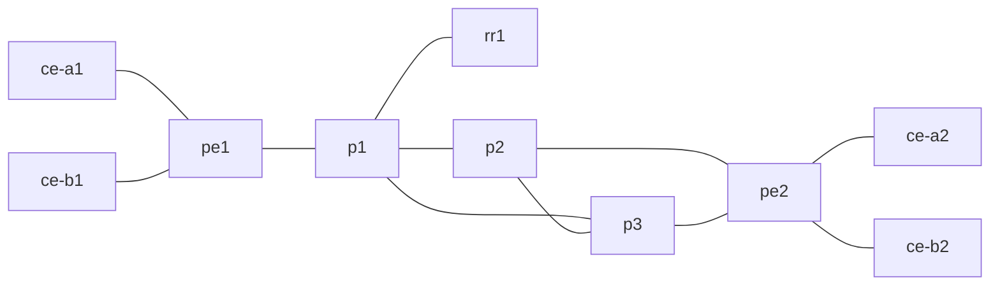

# MPLS L3VPN Backbone Lab

A small, containerized service-provider backbone built with **FRRouting (FRR)** and **Containerlab**. The lab combines an IS-IS underlay, LDP/MPLS transport, and MP-BGP VPNv4 to connect two customer networks through a shared provider core. Both customers reuse the same IPv4 host addresses, while separate VRFs and Route Targets keep their routing tables distinct.

The project is designed for hands-on learning and repeatable experiments—not as a production design or a model of any real operator network. The city references in the topology concept (Rome, Milan, Naples) are illustrative only.

## What this lab demonstrates

- **IS-IS underlay:** Level-2-only routing provides reachability between provider loopbacks.
- **BFD:** configured on the core data links to detect failures faster than relying on routing timers alone.
- **LDP/MPLS transport:** distributes transport labels for routes in the provider network.
- **MP-BGP VPNv4:** carries customer routes between the provider-edge (PE) routers through a route reflector.
- **VRF-based separation:** `VRF_A` and `VRF_B` use separate routing tables even though the tenants reuse the same customer IP addresses.
- **Alternative core paths:** the P-router triangle gives the path toward `pe2` an alternate route, although not every router is dual-homed.
- **Pytest smoke tests:** checks selected IS-IS, MPLS, VPNv4, and customer-connectivity conditions.

## Topology



| Node(s) | Role | Responsibility |
|---|---|---|
| `p1`, `p2`, `p3` | Provider (P) routers | Run the provider underlay and switch transport labels; they do not need customer VRFs. |
| `pe1`, `pe2` | Provider-edge (PE) routers | Connect customer sites, maintain `VRF_A` and `VRF_B`, and exchange VPN routes. |
| `rr1` | BGP route reflector | Reflects VPNv4 routes between `pe1` and `pe2`. |
| `ce-a1`, `ce-a2` | Customer A | Customer A sites, connected to `VRF_A` using eBGP. |
| `ce-b1`, `ce-b2` | Customer B | Customer B sites, connected to `VRF_B` using eBGP. |

The topology contains **10 FRR containers**. `pe1` has one provider uplink to `p1`; `rr1` is also single-homed to `p1`. `pe2`, by contrast, connects to both `p2` and `p3`.

## Routing and addressing model

### Provider loopbacks

| Router | Loopback |
|---|---|
| `pe1` | `10.0.0.1/32` |
| `pe2` | `10.0.0.2/32` |
| `p1` | `10.0.0.11/32` |
| `p2` | `10.0.0.12/32` |
| `p3` | `10.0.0.13/32` |
| `rr1` | `10.0.0.100/32` |

IS-IS advertises the provider loopbacks. LDP uses them as transport addresses, and the PEs use loopback-sourced iBGP sessions to the route reflector in AS `65000`.

### Customer VRFs and overlapping addresses

| Tenant | VRF | RD | RT | Customer endpoint addresses |
|---|---|---|---|---|
| Customer A | `VRF_A` | `65000:100` | `65000:100` | `192.168.1.1/32` at `ce-a1`; `192.168.1.2/32` at `ce-a2` |
| Customer B | `VRF_B` | `65000:200` | `65000:200` | `192.168.1.1/32` at `ce-b1`; `192.168.1.2/32` at `ce-b2` |

**Important:** the current configuration uses overlapping **`/32` loopback routes**, not `192.168.1.0/24` LAN prefixes. The PE–CE transit subnets are also reused between the two VRFs on each PE: `172.16.1.0/30` on `pe1` and `172.16.2.0/30` on `pe2`.

The Route Distinguisher (RD) makes otherwise identical IPv4 routes distinguishable in VPNv4. The Route Target (RT) controls which VPN routes a VRF imports and exports. In this lab, each VRF uses its own RD/RT value, and the customer-facing interfaces are assigned to the corresponding VRF.

### Control-plane protocols

| Layer | Protocol / feature | Purpose |
|---|---|---|
| Underlay | IS-IS Level 2 | Establishes provider IP reachability and calculates paths through the core. |
| Failure detection | BFD | Detects failure on configured core links and informs the routing protocol. |
| Transport | LDP/MPLS | Signals labels for forwarding across the provider network. |
| VPN control plane | MP-BGP VPNv4 | Advertises customer routes with VPN-specific information and labels. |
| Customer routing | eBGP between CE and PE | Exchanges each site's customer routes with its PE. |

BFD is configured on the core data links. It is **not** currently configured on the `p1`–`rr1` link, and the test suite does not yet assert BFD peer state.

## How a packet travels (`ce-a1` → `ce-a2`)

1. `ce-a1` advertises `192.168.1.1/32` to `pe1` over eBGP. The remote route `192.168.1.2/32` is learned in `VRF_A` through the VPN control plane.
2. `pe1` looks up the destination in `VRF_A` and encapsulates the packet with two MPLS labels: the **VPN label** on the inside and the **transport label** on the outside.
3. Provider routers switch the outer transport label. They do not need to inspect the customer's IP routing table.
4. On the selected path, the penultimate router can remove the transport label using penultimate-hop popping (PHP).
5. `pe2` uses the remaining VPN label to select `VRF_A`, then forwards the IP packet to `ce-a2`.

Customer B follows the equivalent process through `VRF_B`, despite using the same customer endpoint addresses.

## Requirements

- A Linux host or VM with a kernel that supports MPLS and VRF interfaces.
- Docker Engine and [Containerlab](https://containerlab.dev/install/).
- Python 3 with `venv` support.
- The host kernel modules/features `mpls_router`, `mpls_iptunnel`, and `vrf` available.
- Permission to run Docker commands as the user that runs pytest. On Linux, this commonly means configuring the Docker group and opening a new login session afterward.

Docker Desktop or WSL2 may require additional kernel/network configuration; a native Linux host or Linux VM is the simplest environment for this lab.

## Quick start

### 1. Load the required kernel modules

Run each `modprobe` separately:

```bash
for module in mpls_router mpls_iptunnel vrf; do
  sudo modprobe "$module"
done
```

### 2. Deploy the topology

From the repository root:

```bash
sudo containerlab deploy -t backbone.clab.yml
```

Wait for the daemons and routing protocols to converge. Allow roughly 30–60 seconds as a starting point, then inspect the control plane if a test fails.

### 3. Install and run the tests

```bash
python3 -m venv .venv
source .venv/bin/activate
python -m pip install --upgrade pip pytest
pytest -v tests/
```

The tests run `docker exec` directly, so the current user must have access to the Docker daemon. These are smoke tests for selected expected states, not a comprehensive conformance or isolation test suite.

### 4. Tear down the lab

```bash
sudo containerlab destroy -t backbone.clab.yml --cleanup
```

## Inspecting the network

Open the FRR CLI on a node:

```bash
docker exec -it clab-telco-backbone-pe1 vtysh
```

Useful commands inside `vtysh` include:

| Command | What it shows |
|---|---|
| `show isis neighbor` | IS-IS adjacencies and state |
| `show mpls ldp neighbor` | LDP neighbors and session state |
| `show mpls ldp binding` | LDP label bindings for prefixes |
| `show mpls table` | MPLS labels installed for forwarding |
| `show bfd peers` | BFD peers and their state |
| `show bgp ipv4 vpn` | VPNv4 routes, including RD information |
| `show bgp vrf all summary` | BGP sessions by VRF |
| `show ip route vrf VRF_A` | Routing table for Customer A on a PE |
| `show ip route vrf VRF_B` | Routing table for Customer B on a PE |

For example, inspect `show ip route vrf VRF_A` and `show ip route vrf VRF_B` on the same PE to compare the customer routing tables.

## Automated tests

The current `tests/test_backbone.py` contains six tests:

| Test | What it checks |
|---|---|
| IS-IS adjacencies | `p1` sees `pe1`, `p2`, and `p3` as up neighbors. |
| LDP labels | The MPLS table on `pe1` contains LDP entries. |
| VPN labels | The MPLS table on `pe1` contains BGP-related entries. |
| Route reflector VPNv4 | The route reflector's VPN table contains RD values `65000:100` and `65000:200`. |
| Customer A connectivity | `ce-a1` can ping `192.168.1.2` using source `192.168.1.1`. |
| Customer B connectivity | `ce-b1` can ping `192.168.1.2` using source `192.168.1.1`. |

These checks confirm selected adjacencies, label-table entries, the presence of both customer RDs at the route reflector, and same-customer reachability when the tests pass. **They do not directly prove cross-tenant isolation**, and they do not measure BFD convergence or failover packet loss.

## Failover experiment

The `p1`–`p2` link is `p1`'s `eth2`. With a continuous ping running from Customer A, bring that interface down in another terminal:

```bash
# Terminal 1: continuous ping

docker exec clab-telco-backbone-ce-a1 ping -I 192.168.1.1 192.168.1.2

# Terminal 2: simulate a link failure on p1 <-> p2
docker exec clab-telco-backbone-p1 ip link set dev eth2 down

# Restore the link after the experiment
docker exec clab-telco-backbone-p1 ip link set dev eth2 up
```

With the current IS-IS metrics, an alternate route is expected through `p1 → p3 → p2 → pe2` while the `p1`–`p2` link is down. Confirm the actual path and recovery behavior from the running lab; reconvergence and packet loss have not been measured in the repository's test suite.

| Configuration | Packet loss | Recovery time |
|---|---:|---:|
| IS-IS timers only | Not measured | Not measured |
| IS-IS + BFD | Not measured | Not measured |

Do not leave `p1`'s `eth2` down when running the normal test suite.

## Repository layout

```text
backbone.clab.yml    Containerlab topology and container startup actions
configs/             FRR configurations and daemon settings for the nodes
tests/test_backbone.py
                     Pytest smoke tests for routing, labels, and connectivity
scripts/              Supporting scripts, if present
docs/                 Additional documentation, if present
```

## Known limitations and next steps

- `pe1` and `rr1` each have a single uplink to `p1`; a failure of `p1` therefore affects both.
- BFD is not enabled on the `p1`–`rr1` link, and BFD state is not asserted by pytest.
- The tests check reachability within each customer VPN but do not include a dedicated negative test for cross-tenant route import or reachability.
- Failover packet loss and convergence time have not been measured.
- Packet captures showing the two-label MPLS stack are not yet included.
- The current customer examples use overlapping `/32` loopbacks; a separate scenario with unique customer prefixes could complement the overlap test.
- Segment Routing (SR-MPLS) and CI integration are possible extensions, not current features.
